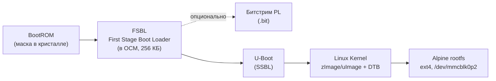

# Загрузочная цепочка: FSBL, U-Boot, ядро Linux и Device Tree

Как устроена загрузка Zynq-7010 (BootROM → FSBL/SPL → U-Boot → ядро → rootfs) и как собрать все компоненты загрузочной цепочки: FSBL, U-Boot (включая путь через SPL), Device Tree, ядро Linux, `BOOT.BIN`, а также сценарии загрузки U-Boot.

rootfs сама по себе не загрузится: нужны FSBL или SPL, U-Boot, ядро и dtb, уложенные на FAT-раздел согласно схеме из [раздела 1](#1-как-устроена-загрузка-zynq-7010). Здесь — минимально достаточный маршрут; каждый из компонентов при желании тюнится отдельно и заметно глубже, чем это уместно в мануале про rootfs.

## Оглавление

- [1. Как устроена загрузка Zynq-7010](#1-как-устроена-загрузка-zynq-7010)
- [2. Кросс-компилятор](#2-кросс-компилятор)
- [3. FSBL](#3-fsbl)
- [4. U-Boot](#4-u-boot)
- [5. Device Tree](#5-device-tree)
- [6. Ядро Linux](#6-ядро-linux)
- [7. Модули ядра в rootfs](#7-модули-ядра-в-rootfs)
- [8. Сборка BOOT.BIN (bootgen)](#8-сборка-bootbin-bootgen)
- [9. Параметры и сценарии загрузки U-Boot](#9-параметры-и-сценарии-загрузки-u-boot)

## 1. Как устроена загрузка Zynq-7010

Прежде чем собирать rootfs, важно понимать, в какую цепочку она встраивается — rootfs не загружается сама по себе.



Пошагово:

1. **BootROM** — неизменяемый код в кристалле. При старте читает состояние MIO-пинов (boot mode) и загружает следующий образ. Для Zynq-7000 значение SD boot mode — `0x5` (младшие четыре бита `0101`); положение джамперов и порядок подписанных MIO сверяйте с руководством именно вашей платы.
2. **FSBL** (First Stage Boot Loader) — считывается из файла `BOOT.BIN` на первом разделе SD-карты (FAT32), выполняется в OCM. Инициализирует DDR-контроллер, тактирование, MIO, опционально конфигурирует PL битстримом, затем передаёт управление SSBL.
3. **U-Boot** (SSBL, second stage) — полноценный загрузчик: консоль, сеть, работа с SD/QSPI, переменные окружения, скрипты `boot.scr`/`uEnv.txt`. Загружает ядро, Device Tree Blob и (если используется) initramfs в DDR и передаёт управление ядру.
4. **Ядро Linux** распаковывается, инициализирует драйверы согласно Device Tree, монтирует корневую ФС по параметру `root=` из `bootargs` — это и есть та самая Alpine rootfs со второго раздела SD-карты (ext4), и запускает `/sbin/init` (OpenRC).

Разметка SD-карты, соответствующая этой схеме:

| № раздела | ФС | Назначение | Типичный размер |
|---|---|---|---|
| 1 | FAT32, флаг boot | `BOOT.BIN`, **также `u-boot.img` для SPL-пути**, `uImage`/`zImage`, `*.dtb`, `boot.scr`/`uEnv.txt` | 128–256 МБ |
| 2 | ext4 | Alpine rootfs (`/`) | остальное место на карте |

## 2. Кросс-компилятор

Для сборки ядра и U-Boot (не самой rootfs — там уже musl/armv7 от Alpine) вполне подходит обычный glibc-кросс-тулчейн из дистрибутива хоста — он не линкуется в конечные бинарники ядра/U-Boot:

```bash
export ARCH=arm
export CROSS_COMPILE=arm-linux-gnueabihf-
```

(пакет `gcc-arm-linux-gnueabihf` уже поставили в [разделе 1.1 страницы «Подготовка хоста»](Host-Build-Environment.md#11-хост-система-и-пакеты)).

## 3. FSBL

FSBL — единственный компонент цепочки, который практически всегда собирается штатными средствами Xilinx/AMD (**Vitis**, бесплатен), так как содержит инициализацию PS (DDR-тайминги, тактирование, MIO), сгенерированную из аппаратного описания платы (`.xsa`):

1. В Vivado откройте (или скачайте у производителя платы) базовый проект/платформу для вашей платы и экспортируйте hardware platform (`.xsa`).
2. В Vitis: **File → New → Application Project** → выбрать `.xsa` → шаблон **Zynq FSBL** → Build. На выходе — `fsbl.elf`.

Если не хотите ставить Vitis — почти все производители плат публикуют готовый `fsbl.elf`/`BOOT.BIN` в репозитории с "boot files"/"boot collateral" для своей платы (например, для Zybo Z7 — в GitHub-репозиториях Digilent). Для первого знакомства с системой это самый быстрый путь.

## 4. U-Boot

### 4.1 Выбор источника и версии

Как и с ядром ([6.1](#61-выбор-источника-и-версии-ядра)), два практических варианта:

- **Mainline (`source.denx.de/u-boot/u-boot.git`)** — чистое дерево, поддержка Zynq-7000 давняя и стабильная.
- **`github.com/Xilinx/u-boot-xlnx`** — форк AMD/Xilinx, обычно чуть богаче готовыми board-defconfig'ами и свежее по PS-специфичным патчам, но менее "чистый", чем mainline.

```bash
git clone https://source.denx.de/u-boot/u-boot.git
cd u-boot
git checkout v2026.04     # актуальный стабильный тег смотрите на source.denx.de/u-boot/u-boot/-/tags
```

Помимо кросс-компилятора, для этого тега на Debian нужны инструменты сборки и host-зависимости:

```bash
sudo apt-get install build-essential bison flex libssl-dev libgnutls28-dev \
    python3 python3-dev python3-setuptools swig device-tree-compiler
```

### 4.2 FSBL или SPL: два пути к первой стадии загрузки

У Zynq-7000 (в отличие от ZynqMP, где это не работает) есть выбор, чем грузить U-Boot: штатным Xilinx-FSBL ([раздел 3](#3-fsbl)) или собственным SPL самого U-Boot, который может полностью заменить FSBL.

| | FSBL + bootgen (разделы [3](#3-fsbl), [8](#8-сборка-bootbin-bootgen)) | SPL самого U-Boot |
|---|---|---|
| Инструменты | Vitis/Vivado (или готовый `fsbl.elf` от вендора платы) + `bootgen` | только сам U-Boot, `bootgen` не нужен |
| Поддержка Xilinx | официальная | нет — в документации Xilinx прямо помечено как "for completeness, not supported"; тем не менее рабочий и распространённый community-путь именно для Zynq-7000 |
| Нужен `ps7_init_gpl.c` | не нужен (инициализацию PS делает сам FSBL) | нужен — но для популярных плат (Zedboard, MicroZed, ZC706, Zybo и др.) он уже лежит в дереве U-Boot, `board/xilinx/zynq/<board>/` |
| Загрузка битстрима PL до Linux | да, штатно через `boot.bif` | через команду `fpga load` в самом U-Boot, либо позже из Linux ([раздел 6.5](#65-динамическая-загрузка-pl-из-linux-fpga-manager)) |
| Итоговый `BOOT.BIN` | собирается `bootgen`'ом ([раздел 8](#8-сборка-bootbin-bootgen)) | `spl/boot.bin` переименовывается в `BOOT.BIN`; **это только SPL**, рядом на FAT обязательно нужен `u-boot.img` |

Для знакомства с платформой и большинства популярных плат — путь через SPL проще и не требует Xilinx-инструментов вообще. FSBL-путь оставляйте для случаев, где нужно штатно зашивать битстрим PL в `BOOT.BIN` при каждой загрузке, либо когда для вашей платы в U-Boot нет готового `ps7_init_gpl.c` и генерировать его самому не хочется (тогда проще собрать FSBL в Vitis один раз).

### 4.3 Конфигурация (defconfig)

В проверенном mainline U-Boot v2026.04 используется общий defconfig `xilinx_zynq_virt_defconfig`, конкретная плата задаётся переменной `DEVICE_TREE`:

```bash
make xilinx_zynq_virt_defconfig
export DEVICE_TREE=zynq-zybo-z7      # имя платы под arch/arm/dts/, замените под вашу плату
```

`zynq_zybo_z7_defconfig` в этом теге **нет**. В иных версиях/форках board-defconfig можно использовать только после проверки, что соответствующий файл существует в `configs/`.

### 4.4 Сборка

```bash
make -j"$(nproc)"
```

Артефакты зависят от выбранного пути ([4.2](#42-fsbl-или-spl-два-пути-к-первой-стадии-загрузки)):

- **SPL-путь**: `spl/boot.bin` (BootROM-образ **только первой стадии**), `spl/u-boot-spl.bin`, `u-boot.img` (U-Boot proper). На первый FAT-раздел нужны **оба** файла: `spl/boot.bin` как `BOOT.BIN` и `u-boot.img` без переименования. В проверенном defconfig SPL ищет именно `u-boot.img` (`CONFIG_SPL_FS_LOAD_PAYLOAD_NAME`). Один `BOOT.BIN` не содержит U-Boot proper.
- **FSBL-путь**: `u-boot.elf` (пойдёт в `boot.bif` вместе с `fsbl.elf` — [раздел 8](#8-сборка-bootbin-bootgen)); отдельный `u-boot.img` на SD для этого пути не требуется. Если SPL для платы не собирается, отключите `CONFIG_SPL` через `menuconfig`, затем пересоберите U-Boot.

```bash
# Только SPL-путь; BOOT — точка монтирования первого FAT-раздела:
cp spl/boot.bin "$BOOT/BOOT.BIN"
cp u-boot.img "$BOOT/u-boot.img"
```

### 4.5 Своя плата или изменённая PL: собственный `ps7_init_gpl.c`

Если для вашей платы в дереве U-Boot нет каталога `board/xilinx/zynq/<board>/` с `ps7_init_gpl.c`, либо вы меняли конфигурацию PS в Vivado (тактирование, DDR, MIO) — файлы нужно сгенерировать самому, точно так же, как для FSBL ([раздел 3](#3-fsbl)):

1. В Vivado экспортируйте hardware platform (`.xsa`).
2. `.xsa` — это zip-архив; извлеките из него `ps7_init_gpl.c`/`ps7_init_gpl.h`:
   ```bash
   unzip design.xsa ps7_init_gpl.c ps7_init_gpl.h -d u-boot/board/xilinx/zynq/<ваша_плата>/
   ```
3. Заведите рядом свой `defconfig`/`.dts` по образцу ближайшей похожей платы (например, `zynq-zc702` как отправная точка).

При любом изменении PS-части проекта в Vivado эти файлы нужно перегенерировать и обновить — иначе плата будет вести себя так же, как при несовпадающем FSBL (см. диагностику в [разделе 1 страницы «Диагностика»](Troubleshooting.md#1-проблемы-загрузки-и-работы-системы-на-плате)).

### 4.6 Переменные окружения: где и как сохраняются

`xilinx_zynq_virt_defconfig` умеет хранить окружение в нескольких местах (`CONFIG_ENV_IS_IN_FAT`, `CONFIG_ENV_IS_IN_SPI_FLASH` и т.д.) и в достаточно новых версиях U-Boot автоматически выбирает конкретное место по фактическому boot mode платы: при загрузке с SD — сохраняет как файл `uboot.env` на FAT-разделе, при загрузке с QSPI — в SPI-флеш.

```
=> printenv                 # текущее окружение
=> setenv myvar somevalue
=> saveenv                  # сохранить постоянно
=> printenv myvar           # после reset значение сохранится
```

Если в выводе `saveenv` видно `Saving Environment to FAT...` — окружение ушло файлом `uboot.env` на первый (FAT) раздел SD-карты, рядом с `BOOT.BIN`. Если значения не переживают перезагрузку — см. таблицу ошибок ниже ([4.8](#48-типичные-ошибки-сборки-и-настройки-u-boot)).

### 4.7 Быстрая проверка через JTAG (без перезаписи SD-карты)

Для отладки удобно не переписывать SD-карту на каждое изменение: `u-boot`/`u-boot.elf` можно докачать напрямую в DDR через JTAG (Vitis/Vivado Hardware Manager или XSDB, у многих отладочных плат JTAG выведен через встроенный USB-мост) уже после того, как PS инициализирован (например, залипанием на точке останова после `ps7_init` либо через отдельный JTAG-скрипт инициализации PS) — и запустить без участия SD-карты и FSBL вообще. Точный синтаксис команд зависит от версии инструментов — см. документацию AMD/Xilinx по JTAG-загрузке (Vitis/XSCT).

### 4.8 Типичные ошибки сборки и настройки U-Boot

| Ошибка | Причина | Решение |
|---|---|---|
| `Please copy ps7_init.c/h from hw project` при сборке SPL | Для платы нет готового `ps7_init_gpl.c` в дереве U-Boot | Сгенерировать свой ([раздел 4.5](#45-своя-плата-или-изменённая-pl-собственный-ps7_init_gplc)) либо перейти на FSBL-путь ([3](#3-fsbl)) |
| `saveenv` отрабатывает, но после перезагрузки значения теряются | Активный `CONFIG_ENV_IS_IN_*` не совпадает с реальным носителем загрузки (например, включён только `SPI_FLASH`, а грузитесь с SD) | Включить `CONFIG_ENV_IS_IN_FAT` для SD-загрузки в `menuconfig` ([раздел 4.6](#46-переменные-окружения-где-и-как-сохраняются)) |
| После SPL — тишина, U-Boot proper не стартует | Отсутствует/неверен `u-boot.img` на FAT либо `ps7_init_gpl.c` не соответствует конфигурации PS | Сначала проверить наличие `u-boot.img` рядом с `BOOT.BIN`, затем обновить PS init под точный `.xsa` ([4.5](#45-своя-плата-или-изменённая-pl-собственный-ps7_init_gplc)) |
| `DEVICE_TREE=...` не находится при сборке | Неверное имя платы в переменной | Сверить точное имя `.dts`-файла в `arch/arm/dts/` дерева U-Boot |
| Плата не грузится ни по одному из путей | В `BOOT.BIN` перепутаны артефакты разных путей (например, `fsbl.elf` + `spl/boot.bin` вместе) | Выбрать один путь ([4.2](#42-fsbl-или-spl-два-пути-к-первой-стадии-загрузки)): либо `bootgen` с FSBL+`u-boot.elf`, либо переименованный `spl/boot.bin` **и отдельный `u-boot.img`** — не смешивать |

## 5. Device Tree

В mainline-ядре и U-Boot общая часть Zynq-7000 вынесена в `zynq-7000.dtsi`, которую подключают платозависимые файлы вида `zynq-<board>.dts` (например, `zynq-zc702.dts`, `zynq-zybo-z7.dts`). Путь у ядра — `arch/arm/boot/dts/` (в части версий — `arch/arm/boot/dts/xilinx/`), у U-Boot — `arch/arm/dts/`. Если вашей платы нет в апстриме — за основу берут ближайший похожий dts и правят под свою обвязку (память, периферию на PL и т.д.).

## 6. Ядро Linux

Апстрим не имеет отдельного Zynq-defconfig — используется общий `multi_v7_defconfig`, либо (проще для новичка, включает больше нужного "из коробки") board-defconfig от Xilinx `xilinx_zynq_defconfig`. Ниже — сборка от клонирования дерева до готовых `uImage`/`modules`/`dtbs`, с настройкой под периферию Zynq PS и типичными ошибками.

### 6.1 Выбор источника и версии ядра

Два практических варианта:

- **Mainline (`github.com/torvalds/linux` или `git://git.kernel.org/...`)** — самый чистый и долгоживущий вариант, поддержка Zynq-7000 в апстриме с ~3.x. Берите LTS-ветку — дольше патчится, стабильнее API для модулей.
- **`github.com/Xilinx/linux-xlnx`** — форк AMD/Xilinx поверх mainline с доп. драйверами под их IP-ядра для PL (видео, DMA-контроллеры, специфичные кодеки и т.п.). Обычно на 1–2 релиза "младше" HEAD мейнлайна. Берите, если в PL стоит нестандартное Xilinx IP без драйвера в апстриме.

```bash
git clone --depth 1 --branch v6.6.155 https://git.kernel.org/pub/scm/linux/kernel/git/stable/linux.git
cd linux
# v6.6.155 — фиксированный пример stable/LTS, актуальные версии и сроки — kernel.org
```

Патч-теги `v6.6.x` находятся в **stable/linux**, а не в `torvalds/linux`: команда `git checkout v6.6.155` после клонирования дерева Torvalds не сработает. Альтернатива для фиксированного примера — официальный архив `https://cdn.kernel.org/pub/linux/kernel/v6.x/linux-6.6.155.tar.xz`.

> Пакет `linux-lts` из репозитория Alpine ориентирован на массовые ARM-платы (Raspberry Pi и т.п.) и с высокой вероятностью не включает поддержку периферии Zynq PS (Cadence UART, GEM Ethernet, Arasan SDHCI) "из коробки" — поэтому для Zynq практически всегда нужна отдельная кросс-сборка ядра, а не `apk add linux-lts`.

### 6.2 Базовая конфигурация (defconfig)

```bash
make ARCH=arm CROSS_COMPILE=arm-linux-gnueabihf- multi_v7_defconfig
# либо, только если брали форк Xilinx с этим defconfig:
# make ARCH=arm CROSS_COMPILE=arm-linux-gnueabihf- xilinx_zynq_defconfig
```

Дальше — точечная донастройка через `menuconfig` ([раздел 6.3](#63-периферия-zynq-ps-что-включить-в-menuconfig)) поверх взятого defconfig. Если правили конфиг вручную и хотите сохранить компактный diff для версионирования (а не полный `.config` на 10000+ строк):

```bash
make ARCH=arm CROSS_COMPILE=arm-linux-gnueabihf- savedefconfig
cp defconfig arch/arm/configs/my_zynq7010_defconfig
```

### 6.3 Периферия Zynq PS: что включить в menuconfig

`multi_v7_defconfig` рассчитан на десятки разных плат сразу, поэтому часть периферии Zynq в нём выключена или собрана модулем. Откройте `make ARCH=arm CROSS_COMPILE=arm-linux-gnueabihf- menuconfig`, ищите опцию по имени через `/` и сверяйтесь с таблицей:

| Периферия | CONFIG-опция | Драйвер | Примечание |
|---|---|---|---|
| Консоль UART | `CONFIG_SERIAL_XILINX_PS_UART` | `xilinx_uartps` | даёт `/dev/ttyPS0`; в `multi_v7_defconfig` обычно уже `=y` |
| Ethernet (GEM) | `CONFIG_MACB` | `macb` | без него не будет `eth0` |
| SD/MMC (загрузка/rootfs) | `CONFIG_MMC_SDHCI_OF_ARASAN` | `sdhci-of-arasan` | нужен как `=y` (не модулем), если rootfs не в initramfs — иначе ядру нечем примонтировать `root=` |
| I2C (PS) | `CONFIG_I2C_CADENCE` | `i2c-cadence` | датчики/EEPROM на I2C1/I2C0 |
| SPI (PS) | `CONFIG_SPI_CADENCE` | `spi-cadence` | SPI-периферия на PS |
| Аппаратный watchdog | `CONFIG_CADENCE_WATCHDOG` | `cadence_wdt` | полезно для автовосстановления при зависании |
| USB host/device | `CONFIG_USB_CHIPIDEA*` | `ci_hdrc` | контроллер ChipIdea; включайте `HOST`/`UDC` под нужный режим |
| CAN (если есть на плате/в PL) | `CONFIG_CAN_XILINXCAN` | `xilinx_can` | точное имя в Linux 6.6.155; требует также CAN core |
| FPGA Manager (динамическая загрузка PL) | `CONFIG_FPGA`, `CONFIG_FPGA_MGR_ZYNQ_FPGA` | `zynq-fpga` | см. [6.5](#65-динамическая-загрузка-pl-из-linux-fpga-manager) |
| UIO для своей PL-периферии | `CONFIG_UIO`, `CONFIG_UIO_PDRV_GENIRQ` | `uio_pdrv_genirq` | см. [6.6](#66-uio-для-собственной-pl-периферии) |
| DMA-буферы для PL (AXI DMA/VDMA и т.п.) | `CONFIG_CMA`, `CONFIG_DMA_CMA` | — | размер области — `CONFIG_CMA_SIZE_MBYTES` либо параметр ядра `cma=` |

Не включайте всё сразу "про запас" — лишние драйверы увеличивают время сборки и размер `modules`; включайте то, что реально распаяно/подключено на вашей плате и описано в её Device Tree ([раздел 5](#5-device-tree)).

Для загрузки ext4-rootfs **без initramfs** также нужны встроенные (`=y`) `CONFIG_MMC`, `CONFIG_MMC_BLOCK`, `CONFIG_MMC_SDHCI`, `CONFIG_MMC_SDHCI_PLTFM`, `CONFIG_EXT4_FS` и их зависимости; для консоли — `CONFIG_SERIAL_XILINX_PS_UART_CONSOLE=y`. В проверенном Linux 6.6.155 `multi_v7_defconfig` эти опции уже включены, но проверяйте итоговый `.config` после своих изменений.

При минимизации ядра для Alpine/OpenRC не убирайте `CONFIG_POSIX_TIMERS=y` и (для совместимости со старым 32-битным time ABI) `CONFIG_COMPAT_32BIT_TIME=y`: без поддержки времени OpenRC `swclock`/`settimeofday` могут завершаться с `Function not implemented`. Нужны также `CONFIG_PROC_FS=y`, `CONFIG_SYSFS=y`, `CONFIG_TMPFS=y`, `CONFIG_DEVTMPFS=y` и `CONFIG_BINFMT_ELF=y`. Если используется штатный OpenRC-сервис BusyBox mdev, записывающий `/sbin/mdev` в `/proc/sys/kernel/hotplug`, включите `CONFIG_UEVENT_HELPER=y`; без него этого sysctl нет. Альтернатива — настроенный netlink-демон mdev/udev вместо legacy hotplug helper, но это требует соответствующих изменений userspace, а не одного отключения опции.

Для запуска всей Alpine rootfs как initramfs с `swclock` сохраните `CONFIG_INITRAMFS_PRESERVE_MTIME=y`. Без него потерянный mtime `/sbin/openrc-run` может вызвать `settimeofday: Invalid argument` у `swclock` и не дать запуститься `syslog` (см. [проверку QEMU](Deployment.md#2-проверка-в-qemu-без-реальной-платы)). Это не требуется для сохранения меток обычного ext4-корня на SD.

### 6.4 Сборка образов

```bash
make ARCH=arm CROSS_COMPILE=arm-linux-gnueabihf- UIMAGE_LOADADDR=0x8000 -j"$(nproc)" uImage modules dtbs
```

- `uImage` — ядро с заголовком U-Boot (см. вариант 1/2 загрузки в [разделе 9](#9-параметры-и-сценарии-загрузки-u-boot));
- `modules` — все `CONFIG_*=m` драйверы, устанавливаются в rootfs отдельной командой ([раздел 7](#7-модули-ядра-в-rootfs));
- `dtbs` — все `.dtb` из `arch/arm/boot/dts/`, включая нужный `zynq-<board>.dtb`.

Если U-Boot собран **с** `CONFIG_CMD_BOOTZ=y`, можно собрать `zImage` вместо `uImage` (без `UIMAGE_LOADADDR`) и грузить его командой `bootz` ([раздел 9](#9-параметры-и-сценарии-загрузки-u-boot), вариант 3). Без поддержки `bootz` этот вариант не работает: используйте `uImage` и загрузчик с `bootm`/поддержкой legacy image либо включите нужные опции. Для Linux 6.6.155 DTB платы лежит, например, в `arch/arm/boot/dts/xilinx/zynq-zybo-z7.dtb`; скопируйте его на FAT под именем `devicetree.dtb`, используемым ниже.

### 6.5 Динамическая загрузка PL из Linux (FPGA Manager)

В отличие от статической схемы "FSBL один раз конфигурирует PL при старте" ([раздел 1](#1-как-устроена-загрузка-zynq-7010)), ядро с `CONFIG_FPGA_MGR_ZYNQ_FPGA` умеет перегружать PL на лету, без перезагрузки платы — через фреймворк FPGA Manager (`drivers/fpga/zynq-fpga.c`). Узел `devcfg@f8007000` (`compatible = "xlnx,zynq-devcfg-1.0"`) уже присутствует в общем `zynq-7000.dtsi`, отдельно прописывать в DT обычно не нужно — достаточно включить в конфиге:

```
CONFIG_FPGA=y
CONFIG_FPGA_MGR_ZYNQ_FPGA=y
```

**В mainline Linux 6.6.155 нет атрибута `/sys/class/fpga_manager/fpga0/firmware`**: FPGA Manager экспортирует только `name`, `state`, `status`. Простая запись имени файла в `firmware` не загружает PL. Загрузка вызывается из kernel-драйвера через `fpga_mgr_load()` либо инфраструктурой FPGA Region/Device Tree overlays, если конкретное дерево ядра и платформа предоставляют способ их применения. Наличие userspace/configfs-интерфейса нельзя предполагать для mainline; в vendor-ядрах оно зависит от версии и патчей.

Битстрим и его byte order должны соответствовать драйверу: `drivers/fpga/zynq-fpga.c` проверяет sync word и требует byte-swapped `.bin`, без контейнера `BOOT.BIN`. Конвертацию и применение overlay сверяйте с документацией используемого Vivado/vendor-ядра. После успешно выполненной загрузки состояние можно читать командой `cat /sys/class/fpga_manager/fpga0/state` (ожидается `operating`). Команда Vivado лишь создаёт битстрим и не предоставляет Linux-интерфейс загрузки.

Для partial reconfiguration и деталей API — `Documentation/driver-api/fpga/fpga-mgr.rst` в дереве ядра.

### 6.6 UIO для собственной PL-периферии

Если в PL стоит собственное IP-ядро без штатного драйвера в апстриме, необязательно писать kernel-модуль: `CONFIG_UIO_PDRV_GENIRQ` (`drivers/uio/uio_pdrv_genirq.c`) мэпит регистры устройства, описанного в Device Tree, в `/dev/uioN`, дальше с ним работают из userspace через `mmap()`. Требуются `CONFIG_UIO=y` и `CONFIG_UIO_PDRV_GENIRQ=y`; синтаксис описания узла в DT — `Documentation/driver-api/uio-howto.rst` в дереве ядра.

В mainline таблица OF-match этого generic-драйвера задаётся параметром `of_id`. Для узла с `compatible = "generic-uio"` при встроенном драйвере добавьте `uio_pdrv_genirq.of_id=generic-uio` в `bootargs`; при модуле используйте `modprobe uio_pdrv_genirq of_id=generic-uio`. Один только DT-узел без этого параметра не обеспечивает привязку драйвера.

### 6.7 Пересборка после изменений

После правки `.config` в `menuconfig` пересобирать всё с нуля не нужно — `make` соберёт только изменившееся:

```bash
make ARCH=arm CROSS_COMPILE=arm-linux-gnueabihf- oldconfig    # актуализировать .config после смены версии ядра
make ARCH=arm CROSS_COMPILE=arm-linux-gnueabihf- UIMAGE_LOADADDR=0x8000 -j"$(nproc)" uImage modules dtbs
```

### 6.8 Типичные ошибки сборки ядра

| Ошибка | Причина | Решение |
|---|---|---|
| `fatal error: openssl/opensslv.h: No such file` | Не хватает `libssl-dev` (нужен для подписи модулей/certs) | Установить `libssl-dev` ([раздел 1.1 страницы «Подготовка хоста»](Host-Build-Environment.md#11-хост-система-и-пакеты)) |
| `Cannot generate ELF output` / ругань на `libelf` | Не хватает `libelf-dev` (нужен `objtool`/`CONFIG_BPF`) | `sudo apt-get install libelf-dev` |
| `Warning (unit_address_vs_reg)` от DTC | Несоответствие `reg`/адреса узла в DTS | Обычно не критично; при желании поправить `unit-address` в DTS |
| `arm-linux-gnueabihf-gcc: command not found` | Тулчейн не установлен, либо `CROSS_COMPILE` без завершающего дефиса | Проверить `which arm-linux-gnueabihf-gcc`; значение — `arm-linux-gnueabihf-` (с `-` на конце) |
| Сборка прошла, но `uImage` не появился | На хосте нет `mkimage` (пакет `u-boot-tools`) | Установить `u-boot-tools` ([раздел 1.1 страницы «Подготовка хоста»](Host-Build-Environment.md#11-хост-система-и-пакеты)) |
| `make menuconfig` падает с ошибкой ncurses | Не хватает `libncurses-dev` | Установить `libncurses-dev` ([раздел 1.1 страницы «Подготовка хоста»](Host-Build-Environment.md#11-хост-система-и-пакеты)) |
| После сборки нет нужного `/dev/ttyPS0`/`eth0`/… | Опция периферии осталась выключенной или модулем без автозагрузки | Сверить с таблицей в [6.3](#63-периферия-zynq-ps-что-включить-в-menuconfig), для модулей — `apk add kmod` и явный `modprobe` или запись в `/etc/modules` |

## 7. Модули ядра в rootfs

Следующая команда выполняется **из родительского каталога**, содержащего `linux/` (после сборки внутри `linux` сначала `cd ..`). `ROOTFS` должен быть непустым абсолютным путём к подготовленной целевой rootfs, не `/`:

```bash
: "${ROOTFS:?задайте абсолютный путь к целевой rootfs}"
sudo apt-get install kmod   # host depmod для modules_install
sudo make -C linux ARCH=arm CROSS_COMPILE=arm-linux-gnueabihf- \
    INSTALL_MOD_PATH="$ROOTFS" modules_install
```

## 8. Сборка BOOT.BIN (bootgen)

> Этот шаг нужен только для **FSBL-пути** ([раздел 4.2](#42-fsbl-или-spl-два-пути-к-первой-стадии-загрузки)). Если U-Boot собирался со своим SPL — `bootgen` не требуется: скопируйте `spl/boot.bin` как `BOOT.BIN` **и отдельный `u-boot.img`** на FAT ([4.4](#44-сборка)), затем переходите к [разделу 1 страницы «Развёртывание и первая загрузка»](Deployment.md#1-перенос-rootfs-и-загрузочных-файлов-на-sd-карту).

`BOOT.BIN` — это FSBL (+опционально битстрим PL) + U-Boot, упакованные утилитой `bootgen` (входит в состав Vitis/Vivado). Файл `boot.bif`:

```
the_ROM_image : {
    [bootloader] fsbl.elf
    u-boot.elf
}
```

```bash
bootgen -image boot.bif -arch zynq -o BOOT.BIN -w on
```

Если в проекте используется PL-битстрим, добавьте его строкой между `[bootloader] fsbl.elf` и `u-boot.elf` — порядок файлов в `.bif` важен (см. схему в [разделе 1](#1-как-устроена-загрузка-zynq-7010)).

## 9. Параметры и сценарии загрузки U-Boot

Ключевые параметры ядра в `bootargs`: консоль на `ttyPS0` и корень на втором разделе SD-карты с `rootwait` (ядро должно подождать, пока SD-контроллер проинициализируется, иначе получите панику "unable to mount root fs").

**Вариант 1 — `uEnv.txt`** (только если окружение вашей платы явно импортирует этот файл и запускает `uenvcmd`; один `CONFIG_DISTRO_DEFAULTS` этого **не гарантирует**, в проверенном mainline Zynq v2026.04 такого автоматического импорта нет):

```
bootargs=console=ttyPS0,115200 root=/dev/mmcblk0p2 rw rootwait
uenvcmd=fatload mmc 0 0x03000000 uImage; fatload mmc 0 0x02A00000 devicetree.dtb; bootm 0x03000000 - 0x02A00000
```

**Вариант 2 — `boot.scr`** (рекомендуется для проверенного `xilinx_zynq_virt_defconfig`; требуются `CONFIG_CMD_SOURCE`, MMC/FAT, `bootm` и поддержка формата образа, а автоматический запуск зависит от `bootcmd`/distro-окружения — не от одного наличия файла):

`boot.cmd`:
```
fatload mmc 0 0x03000000 uImage
fatload mmc 0 0x02A00000 devicetree.dtb
setenv bootargs console=ttyPS0,115200 root=/dev/mmcblk0p2 rw rootwait
bootm 0x03000000 - 0x02A00000
```

```bash
mkimage -A arm -O linux -T script -C none -a 0 -e 0 -n "boot script" -d boot.cmd boot.scr
```

Если автозапуск не настроен, выполните в консоли U-Boot (FAT на `mmc 0:1`, адрес должен быть свободен):

```
fatload mmc 0:1 ${scriptaddr} boot.scr
source ${scriptaddr}
```

**Вариант 3 — если собирали `zImage` вместо `uImage`** (без `mkimage`-обёртки, команда `bootz` вместо `bootm`):

```
fatload mmc 0 0x02000000 zImage
fatload mmc 0 0x02A00000 devicetree.dtb
setenv bootargs console=ttyPS0,115200 root=/dev/mmcblk0p2 rw rootwait
bootz 0x02000000 - 0x02A00000
```

Адреса загрузки (`0x02000000` и т.д.) — примеры, а не гарантия безопасности: проверьте объём DDR, размеры ядра/DTB/initramfs, область распаковки ядра и память, занятую U-Boot (`bdinfo`). Особенно не допускайте пересечения загруженного zImage и DTB. Номер `mmc 0:1`, `root=/dev/mmcblk0p2` и `ttyPS0` также сверяйте с вашей платой/DT и фактическим порядком контроллеров.

---

← [Сборка rootfs](Rootfs-Build.md) · [Главная](Home.md) · [Развёртывание и первая загрузка](Deployment.md) →
