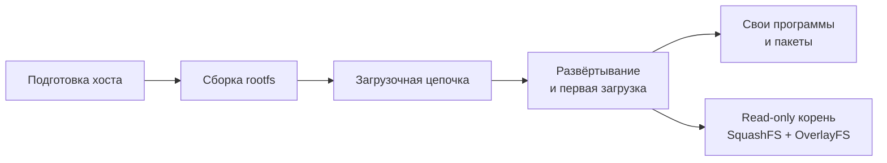

# Alpine Linux 3.20 (armv7) для Xilinx/AMD Zynq-7010 — вики

Технический гайд по сборке **Alpine Linux 3.20 (ветка v3.20)** для встраиваемых систем на базе **Xilinx (ныне AMD) Zynq-7010**: от загрузочной цепочки (FSBL/SPL, U-Boot, ядро, Device Tree) до готовой SD-карты с работающей системой, а также сборка собственных `.apk`-пакетов и неизменяемый (read-only) корень на SquashFS + OverlayFS.

| Параметр | Значение |
|---|---|
| SoC | Xilinx/AMD Zynq-7010, кристалл **XC7Z010** (ARM Processing System + FPGA Programmable Logic) |
| Процессор | двухъядерный **ARM Cortex-A9** (ARMv7-A, VFPv3-D16, Thumb-2) |
| Архитектура Alpine | **`armv7`** (не `armhf` — почему, см. [«Введение», раздел 2](Introduction.md#2-прочитайте-перед-началом)) |
| C-библиотека | **musl libc** |
| Система инициализации | OpenRC, `/dev` — `mdev` (busybox) |
| Примеры плат | Digilent Zybo Z7-10, MYIR Z-turn Lite, Trenz TE0715-02-10 или собственная плата на XC7Z010 |

> Проверено по состоянию на **30 августа 2026 г.** Версии пакетов, ядра и U-Boot меняются со временем — сверяйтесь с официальными источниками ([«Источники и ссылки»](References.md)).
>
> **Ветка Alpine 3.20 достигла End-of-Life 1 апреля 2026 г.** — подробности и рекомендации см. во [«Введении»](Introduction.md#2-прочитайте-перед-началом).

## Оглавление

1. [Введение](Introduction.md) — назначение мануала, границы охвата, статус поддержки Alpine 3.20, выбор `armv7` вместо `armhf`.
2. [Подготовка хоста](Host-Build-Environment.md) — требования к x86_64-хосту и целевому оборудованию, пакеты хоста, статический `apk.static`, chroot на `qemu-user-static` + `binfmt_misc`.
3. [Сборка rootfs](Rootfs-Build.md) — разметка SD-карты, bootstrap rootfs через `alpine-minirootfs` или `apk.static`, настройка системы внутри chroot (репозитории, пакеты, fstab, консоль `ttyPS0`, сеть, пользователи, OpenRC).
4. [Загрузочная цепочка](Boot-Chain.md) — как устроена загрузка Zynq-7010, `BOOT.BIN`, FSBL, U-Boot SPL, кросс-компиляция ядра и Device Tree, модули ядра, сценарии загрузки U-Boot.
5. [Развёртывание и первая загрузка](Deployment.md) — перенос rootfs и загрузочных файлов на SD-карту, проверка в QEMU, первая загрузка платы.
6. [Кросс-компиляция](Cross-Compilation.md) — сборка собственных программ под armv7/musl (chroot или тулчейн Bootlin), C++/Go/Rust, Makefile/CMake, автозапуск через OpenRC, отладка через gdbserver.
7. [Сборка пакетов](Packaging.md) — собственные `.apk` через `abuild`: пользователь `builder`, ключи подписи, анатомия `APKBUILD`, подпакеты, публикация репозитория и деплой на плату.
8. [SquashFS + OverlayFS](SquashFS-OverlayFS.md) — неизменяемый корень: опции ядра, сборка SquashFS-образа, кастомный initramfs и `/init`, stateless- и persistent-режимы, загрузка через U-Boot.
9. [Скрипт сборки rootfs](Build-Script.md) — единый shell-скрипт, автоматизирующий bootstrap и настройку rootfs.
10. [Диагностика](Troubleshooting.md) — типичные проблемы загрузки и работы системы на плате, ссылки на тематические таблицы ошибок.
11. [Источники и ссылки](References.md) — документация Alpine, AMD/Xilinx, U-Boot, ядра Linux и QEMU.

## Рекомендуемый порядок работы

1. Подготовить хост: пакеты, `apk.static`, регистрация `binfmt_misc` — [Подготовка хоста](Host-Build-Environment.md).
2. Разметить SD-карту, собрать и настроить rootfs в chroot — [Сборка rootfs](Rootfs-Build.md) (или автоматически — [Скрипт сборки rootfs](Build-Script.md)).
3. Собрать FSBL/SPL, U-Boot, ядро, Device Tree и `BOOT.BIN` — [Загрузочная цепочка](Boot-Chain.md).
4. Перенести всё на SD-карту, проверить в QEMU и загрузить плату — [Развёртывание и первая загрузка](Deployment.md).
5. По необходимости: свои программы ([Кросс-компиляция](Cross-Compilation.md)), свои пакеты ([Сборка пакетов](Packaging.md)), защищённый от обрыва питания корень ([SquashFS + OverlayFS](SquashFS-OverlayFS.md)).

## Что дальше

- **Сборка собственных `.apk`-пакетов** под armv7/armhf из исходников (когда нужного пакета нет в `main`/`community`) делается через `abuild`/aports-дерево — подробно на странице [«Сборка пакетов»](Packaging.md).
- **QSPI-загрузка вместо SD** — тот же `BOOT.BIN`, только прошивается через U-Boot (`sf` команды) или Vivado/XSCT в QSPI flash; полезно для продакшена без SD-карты.
- **Squashfs/overlay для read-only корня** — если нужна защита от порчи ФС при внезапном отключении питания (типично для embedded), стоит посмотреть в сторону `overlayfs` поверх read-only ext4/squashfs — полностью разобрано на странице [«SquashFS + OverlayFS»](SquashFS-OverlayFS.md).
- **Secure Boot** — Zynq-7000 поддерживает аппаратное шифрование/подпись загрузочного образа (AES-256 + HMAC) через тот же `bootgen`; см. UG585 и UG1283 на странице [«Источники и ссылки»](References.md).

## Об этой вики

Вики собрана из документов в корне репозитория, которые остаются исходными: [`README.md`](../README.md) (rootfs и загрузочная цепочка), [`PACKAGING.md`](../PACKAGING.md) (сборка пакетов) и [`SQUASHFS-OVERLAY.md`](../SQUASHFS-OVERLAY.md) (read-only корень). При изменении материала обновляйте и исходный документ, и соответствующую страницу вики.

---

[Главная](Home.md) · [Введение](Introduction.md) →

